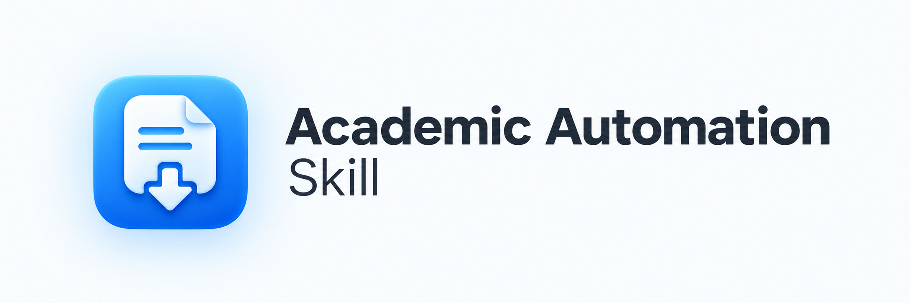
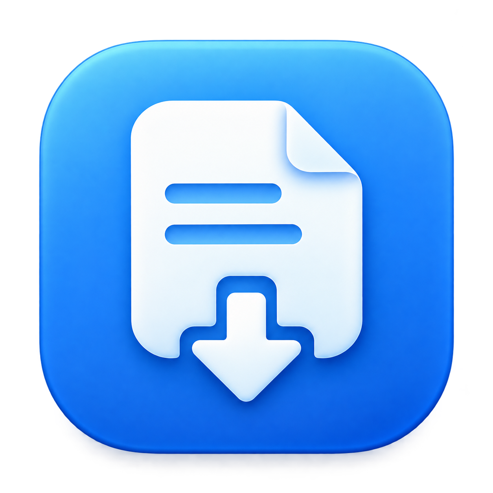

#  Academic Automation Skill

[English](README.md) | **简体中文**

> **重要权限与安全提示：本 Skill 在 macOS 上做界面自动化和 PDF 原生保存时，会让 Agent/Harness 向你索要系统无障碍（辅助功能）权限，以及控制 Chrome 和 System Events 的自动化权限。无障碍权限可以控制整个系统界面，范围不限于某个网页。若有任何安全顾虑，请勿使用本 Skill，也不要授予这些权限。**
>
> **Windows 包同样附带此提示。Windows 目前通过 Playwright 扩展操作网页，系统保存窗口由你自己处理。Agent/Harness 若请求其他系统控制权限，请自行审慎判断。**

把这个 Skill 装进 AI Agent 之后，你可以直接用中文告诉 Agent 要找什么文献。Agent 会到 PubMed 和中国知网检索，也能用 Web of Science 或 Google Scholar，整理出带链接的题录，并在你有权访问时把全文下载到你的文献目录。遇到登录、验证码，或者需要你做决定时，它会停下来问你。

它用的是你自己已登录的 Chrome 和你本人的账户或机构权限。本项目不提供任何数据库账户，也不能帮你免费拿到付费文献。

当前版本是 **2.0.0 RC2 候选版**，改动见[发布说明](RELEASE_NOTES.md)，实测范围见[验证记录](VERIFICATION.md)。

## 能做什么

| 你想做的事 | 可以这样说 |
| --- | --- |
| 按主题检索并整理目录 | “在知网找项目式学习相关的中文期刊论文，只做目录” |
| 检索后下载能拿到的全文 | “在 PubMed 搜 Mendelian randomization，能下则下” |
| 按清单逐篇下载 | “按这份题名清单从知网下载，第一作者在第二列” |
| 只用 PMC，不开浏览器 | “这些 PMID 只从 PMC 下载，没有的保留题录” |
| 已知 DOI，下载外文全文 | “下载这个 DOI 的全文，存到 文献/英文 目录” |

### 支持的数据库

| 来源 | 检索与题录 | 全文下载 | 状态 |
| --- | --- | --- | --- |
| PubMed | 官方接口，不需要浏览器 | PMC 公开 PDF；其余经出版社 | 预览 |
| 知网中文库 | 支持普通检索和专业检索 | 支持，需要提供第一作者 | 已支持 |
| 知网外文库 | 支持 | 页面上没有知网下载按钮，凭完整 DOI 转到出版社 | 已支持 |
| Web of Science | 支持 | 凭 DOI 转到出版社 | 已支持 |
| Google Scholar | 支持 | 凭 DOI 转到出版社 | 已支持 |

每条题录都带可点击的发布页链接，找不到链接的条目会单独列为待补。全文归档前会检查文件是否完整。装了可选的 `pypdf` 后，还会核对首页题名和作者，避免把附录或别的论文当成正文。归档时沿用你已有的目录结构，同名文件不会被覆盖。检索和批量下载中断后可以接着跑。

网站改版或调整登录方式后，部分自动化可能暂时失效。

## 平台与依赖

| 平台 | 浏览器控制方式 | 状态 |
| --- | --- | --- |
| macOS | Apple Events 控制日常 Chrome，原生保存窗口通过 System Events 操作；不使用 Playwright | 主要开发和实测平台 |
| Windows 10/11 | Playwright CLI 加官方 Chrome 扩展，首次连接前需要提供扩展 Token | 预览。测试者已回报 PubMed 检索、题录和两篇 PMC 下载跑通，RC2 的扩展和出版社流程仍待 Windows 实机验收 |
| Linux | 无 | 只支持离线数据处理 |

所有平台都需要 Python 3.9 或更高版本，新安装建议用 3.11 以上。Windows 浏览器流程还要 Node.js 22 以上。只用 PubMed 接口或仅 PMC 下载时，只要 Python 和网络，不需要 Chrome、Node.js 或扩展。

浏览器目前只支持 Google Chrome。

## 安装

1. 从 [RC2 Release](https://github.com/spectrum527/academic-automation-skill/releases/tag/v2.0.0-rc.2) 下载对应平台的包，`-windows.zip` 或 `-macos.zip`。包里不带 Python、Node.js 和 Chrome。
2. 将完整技能文件夹放进你所用 Agent 的 Skill 目录。当前源码及新构建包的目录名与 Skill 名均为 `academic-automation`；历史发布包仍以包内 `SKILL.md` 的名称为准。用 Codex 时，可以从当前源码目录复制过去。

   ```bash
   cp -R . ~/.agents/skills/academic-automation
   ```

   从已有安装升级时，替换旧的活动 Skill，避免同时加载新旧名称的两份安装；保留任务记录和已下载文献。

3. 按平台完成浏览器配置。
   - macOS：在 Chrome 菜单中打开 View → Developer → Allow JavaScript from Apple Events。需要自动保存 PDF 时，再在“系统设置 → 隐私与安全性 → 辅助功能”里授权实际运行 Agent 的应用。详见 [macOS 安装](references/install-macos.md)。
   - Windows：安装微软 Playwright 官方 Chrome 扩展，在解压目录运行 `npm.cmd ci --ignore-scripts`，并把扩展 Token 提供给运行 Agent 的进程环境。详见 [Windows 安装](references/install-windows.md)。
4. 可选：在 Skill 目录运行 `python3 -m pip install -r requirements-pdf.txt`（Windows 用 `py -3`），启用正文自动核验。不装也能归档，Agent 会注明“正文未自动核验”。

macOS 另有可选的 [Legacy Version 1](LEGACY.md)，即旧版 1.6.0，没有 PubMed 和 Windows 支持。它保留冻结版本的 Skill 名，切换时只保留一个活动版本。

历史 macOS 版本在 OpenCode 和 Qoder 中测试过，Cursor 与 OpenAI Codex 上也测过。新的跨平台版本还需要重新验收。不同 Agent 调用 Skill 和工具的方式不一样，表现不保证完全一致。

Agent 的操作规则写在 `SKILL.md`，命令行用法见[统一命令行](references/cli.md)。

## Agent 什么时候会停下来问你

下面这些情况，Agent 会暂停当前文献，说明需要你做什么，等你回复后再继续。没有回复或等待超时，都不算你同意跳过。

- **订阅范围**：检索 PubMed、知网外文库、WoS 或 Scholar 前，你没说明的话，它会先问是否考虑付费或订阅文献；你不考虑时，再问这些文献是放弃还是保留题录。同意考虑订阅，只代表它可以尝试你现有的机构权限，它不会替你购买。
- **验证码、登录和人机验证**：它不会自动绕过，由你在浏览器里完成后继续。
- **PDF 无法自动保存**：如果自动保存和下载目录里都找不到文件，它会问你这类文献是只整理题录，还是保留每篇的标签页，最后由你批量手动下载。手动保存的文件仍会经过核验再归档。
- **题名可能提取错了**：PDF 里提取出的题名和预期对不上，可能只是字形识别误差，它会把两边的题名、作者和 DOI 给你看，你确认后才归档。
- **无法判断是否免费**：出版社页面缺少本篇的免费证据时，它会保留待你判断，不会自动排除。

你说“全部停”时，它会取消整批任务并记录下来，之后重跑也不会自动恢复。

## 账户、访问与使用

- 本项目不提供 CNKI、Google Scholar、Web of Science 等数据库的账户、订阅或机构权限，不包含开发者的账户或登录状态。
- 所有访问都通过你自己的浏览器、账户和已有权限完成。Agent 不导出 Cookie，也不复制浏览器配置。
- 本项目不绕过身份验证、付费墙、验证码或其他访问控制，也不托管、出售或分发任何数据库的全文。
- 请控制自动化任务的规模和频率，并遵守相关数据库和所在机构的规则。你需要自行确认使用方式符合平台规则、机构许可协议和相关法律法规。
- 本项目是独立的个人项目，与 CNKI、Google Scholar、Web of Science 及其运营方没有隶属、合作、赞助或认可关系。相关名称和商标归各自权利人所有。
- 第三方网站可能随时修改服务条款、技术措施和访问政策，维护者无法保证它们始终允许或兼容自动化访问。

## 开发

这是一个主要用 Vibe Coding 开发的个人项目。需求和功能方向由维护者决定，测试与发布也由维护者负责。写代码和调试时大量使用了生成式 AI，主要是 Cursor 和 OpenAI 的 ChatGPT，重构、写文档和讨论设计也用到了它们。我认为 AI 辅助是本项目开发方式的一部分，所以在这里写明。

离线测试不访问任何网站或账户。

```bash
python3 -B -X utf8 -m unittest discover -s tests -v
```

打包用 `python3 scripts/build_release.py`，产物在 `dist/`。更多验收说明见 [平台验收](references/acceptance.md) 和 [VERIFICATION.md](VERIFICATION.md)。

目前的重点是提高各数据库检索的稳定性，改进筛选和整理，跟进网站改版，测试不同 Agent 的兼容性，以及和测试者一起完善 Windows 支持。网站改版后哪里失效了，欢迎提 issue，测试反馈和兼容性报告也欢迎。

## 更新日志

- **2.0.0 RC2**：迁移仓库，更新文档与视觉标识，安装包补齐 README 图片。见[发布说明](RELEASE_NOTES.md)。
- **2.0.0 RC1**：PubMed 与 Windows 流程修复，保留历史发布。
- **1.6.0**（2026-09-12）降低初始上下文占用，支持断点续跑。
  - 流程与排错参考文档按需加载；`SKILL.md` 从 13,696 缩至 3,108 字符，减少 77.3%。
  - 按页面稳定状态与文件完成状态等待；WoS 滚动时累计保留被虚拟列表回收的记录，下载等待期间持续识别收费页或验证码。
  - 检索分页与元数据采集支持续跑；批量条目按文献身份去重；专业检索索引缓存 24 小时，命中后仍实时核对详情。
  - 中文下载启动前统一校验第一作者；未知出版社使用共享单标签导航。
  - 新增 16 项回归测试与[验证记录](VERIFICATION.md)，覆盖真实 CNKI、WoS、Scholar 及 OA 下载流程。
- **1.5.1**（2026-08-26）修正中文库匹配与落盘。题名检索改 `korder=TI`；精确匹配优先（多条包含匹配不再取首条）；短题名无作者退出 64；`--affiliation` 带上 `TI=`/`AU=`；点下载前后轮询详情/收费/验证页；按 mtime 归档；验证码先查落盘；同 tab 导航覆盖 WoS/Scholar/外文；状态表两种表头；无 URL 题录不写入清单。
- **1.5.0**（2026-08-26）提高中文库下载稳定性。
  - `cnki_dl.sh`：结果行作者校验（短题名 ≤6 字必须给作者）；`--expert` 专业检索（`SU='A' AND SU='B'`，绕开点不动的高级检索按钮）；`--affiliation` 机构过滤；检索 URL 自动去掉 `《》〈〉""——`；NOMATCH 自动翻最多 3 页（`--pages`）；同 tab `set URL` + 跳转前 `window.stop()`；退出码 5 识别 `bar.cnki.net/bar/fee` 收费页。
  - 新增 `scripts/cnki_batch.py`：`i/N` 进度、按序号定位的幂等状态表、验证码暂停续传、每 10 篇清理前置窗口多余标签。
  - 新增 `scripts/cnki_next.js`、`scripts/cnki_url.js`。
  - `SKILL.md`：动手前先扫工作区、专业检索用法、「已知坑」（zsh `IFS`、跨设备 `shutil.move`、JS 返回值、`bar.cnki.net` 订单页耗时）。
- **1.4.1** 新增知网外文库（WWJD）、带引号短语检索、DOI 补全、出版社 OA 分流（`oa_dl.sh`），以及 Web of Science 和谷歌学术流程。

## 许可证

[MIT License](LICENSE)
